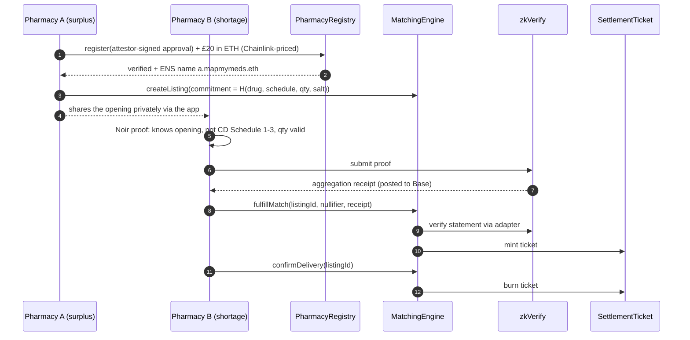

# MapMyMeds

**Privacy-preserving medicine stock matching between UK pharmacies, on Base.**

When a patient's medicine is out of stock, pharmacies today ring round. MapMyMeds lets verified pharmacies see where stock is, and move surplus to where it is needed, without publishing any pharmacy's stock list or any medicine name onchain. Piloting in Leeds (LS1 City Centre and LS13 Bramley).

[](https://github.com/benpaymaster/mapmymeds/actions/workflows/contracts.yml)

| | |
| --- | --- |
| Contracts | Solidity 0.8.33, OpenZeppelin 5.4, Foundry |
| Zero knowledge | Noir circuit, UltraHonk proofs verified on **zkVerify** |
| Oracles | **Chainlink** ETH/USD, GBP/USD and L2 Sequencer Uptime feeds |
| Names | **ENS** subnames on Base via Durin (`everest-bramley.mapmymeds.eth`) |
| Indexing | **The Graph** subgraph |
| Network | **Base** (Base Sepolia for the pilot) |
| Quality | 119 Foundry tests (unit, fuzz, stateful invariants), 100% line coverage, 98% branch coverage, 7 circuit tests, Slither: 0 findings, CI on every push |

---

## How it works



### Contracts

| Contract | Role |
| --- | --- |
| [`PharmacyRegistry`](contracts/PharmacyRegistry.sol) | Source of truth for verified pharmacies. EIP-712 attestor-signed onboarding with nonces, deadlines, expiry and revocation. Charges the one-off registration fee and issues ENS names. |
| [`PharmacyMatchingEngine`](contracts/PharmacyMatchingEngine.sol) | Surplus listings as salted commitments; claims require a zero-knowledge compliance proof bound to the claimant. Lifecycle: Active, Cancelled, Fulfilled, Completed. |
| [`SettlementTicket`](contracts/SettlementTicket.sol) | ERC-721 representing a transfer that is due. Token ID equals listing ID; minted on match, burned on delivery; transferable only between verified pharmacies. |
| [`PharmacyInventory`](contracts/PharmacyInventory.sol) | One Merkle root of salted stock bands per pharmacy, with freshness checks. No medicine names onchain. |
| [`ZkVerifyComplianceVerifier`](contracts/ZkVerifyComplianceVerifier.sol) | Checks zkVerify aggregation receipts for statements of this circuit's verification key. |
| [`GbpFeeQuoter`](contracts/GbpFeeQuoter.sol) | Prices sterling fees in ETH with Chainlink, guarding against stale prices and Base sequencer outages. |
| [`PharmacyNames`](contracts/PharmacyNames.sol) | Durin registrar issuing ENS subnames to newly verified pharmacies. |
| [`transfer_compliance`](circuits/transfer_compliance/src/main.nr) | Noir circuit for the compliance proof. |

### Design decisions

- **No health or stock data onchain.** Listings and inventory hold salted commitments and Merkle roots only. An auditor can verify what the app shows without the chain revealing it.
- **Verify ZK proofs on zkVerify, not Base.** Verifying UltraHonk directly on Base costs millions of gas; checking a zkVerify aggregation receipt costs a Merkle inclusion proof.
- **Proofs are bound to the claimant.** The recipient's address is a public input, so a proof copied from the mempool is useless to anyone else.
- **Interfaces at every boundary.** The engine depends on `IComplianceVerifier`, so the circuit or proof system can be upgraded by deploying a new adapter.
- **Minimal admin power.** Two-step ownership to a Safe; registry and ticket addresses are immutable; nobody can mint tickets directly; suppliers can always cancel, even while paused.

See [docs/SECURITY_REVIEW.md](docs/SECURITY_REVIEW.md) for the full review of v1, the fixes, trust assumptions and the Slither triage.

---

## Getting started

```bash
git clone --recursive https://github.com/benpaymaster/mapmymeds
cd mapmymeds
forge build
forge test                      # unit, fuzz and invariant tests
forge test --gas-report
forge coverage --report summary
```

Circuit (Noir 1.0.0-beta.15, bb 3.0.x):

```bash
cd circuits/transfer_compliance
nargo test
./prove.sh                      # generates and verifies an UltraHonk proof for zkVerify
```

Subgraph:

```bash
cd subgraph
npm install && npm run abis && npm run codegen && npm run build
```

## Deploying to Base Sepolia

Keys never go in `.env`. Use an encrypted Foundry keystore:

```bash
cast wallet import deployer --interactive
cp .env.example .env            # fill in feeds, zkVerify, owner Safe, attestor
source .env
forge script script/Deploy.s.sol --rpc-url base_sepolia --account deployer --broadcast --verify
```

Then:

1. From the owner Safe, call `acceptOwnership()` on the registry, engine, ticket and inventory.
2. If using ENS, call `addRegistrar(<PharmacyNames>)` on your Durin registry.
3. Put the printed addresses and start block into `subgraph/subgraph.yaml` and deploy the subgraph.

The deploy script itself is tested in `tests/smart_contracts/Deploy.t.sol`.

## Repository layout

```
contracts/              Solidity contracts and interfaces
circuits/               Noir zero-knowledge circuit
script/                 Foundry deploy script
tests/smart_contracts/  Unit, fuzz and invariant tests, mocks
subgraph/               The Graph schema and mappings
docs/                   Security review, gas baseline
.github/workflows/      CI: fmt, build, tests, Slither, circuit tests
```

## Status

- Pilot pharmacies in Leeds; in discussion with Leeds Teaching Hospitals NHS Trust's innovation incubator.
- Contracts: self-reviewed and tested; external audit planned before mainnet.

## Author

**Adegbenga (Ben) Ogungbeje**, founder and engineer. [mapmymeds.com](https://mapmymeds.com)

## Licence

MIT
